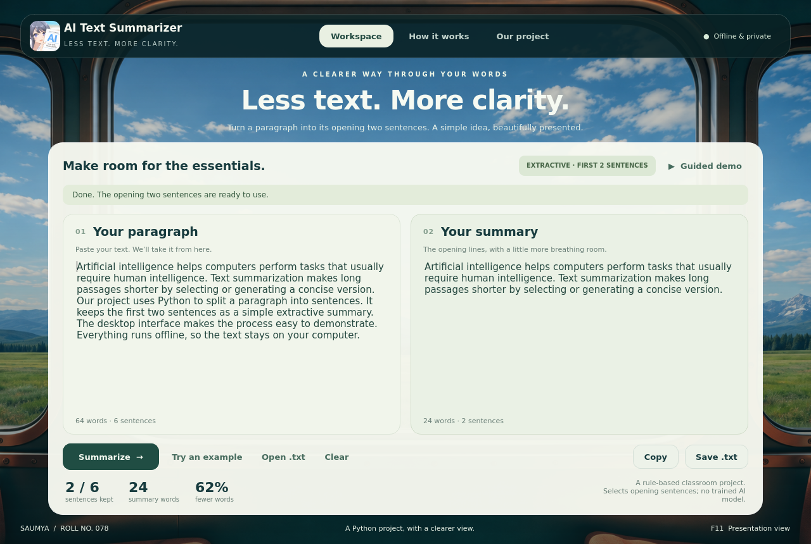

# AI Text Summarizer

**Less text. More clarity.**

A Python desktop project that turns a paragraph into a shorter extract by keeping its first two sentences. It includes a polished interface, a guided classroom demonstration, readable source code, project documents, and a Windows installer that creates a desktop shortcut.

> This is a simple **rule-based extractive summarizer**. “AI Text Summarizer” is the project title. The current version does not use a trained AI model or rewrite the text.



## Download and run the Windows app

[**Download AI_Text_Summarizer_Setup.exe**](downloads/AI_Text_Summarizer_Setup.exe?raw=true)

1. Download the setup file using the link above.
2. Double-click **AI_Text_Summarizer_Setup.exe**.
3. Follow the setup steps and click **Finish**.
4. Open **AI Text Summarizer** using the shortcut created on your desktop.

The installer is for **64-bit Windows 10 or Windows 11**. Python and the interface components are included, so you do not need to install Python separately. The complete installer and the app work offline.

The app is installed for your Windows user account. It also appears in the Start menu. To remove it later, use Windows **Installed apps** or the app's **Uninstall** shortcut in the Start menu.

## What the project does

The app takes text that you type, paste, or open from a text file. It separates the text into sentences and shows the first two in the summary panel. Both panels stay visible, making the result easy to compare with the source.

The project demonstrates Python strings, lists, conditions, functions, regular expressions, input validation, and button-driven desktop programming.

### Main features

- Separate panels for the input paragraph and the summary.
- A **Try an example** button with a ready-to-use demonstration paragraph.
- A **Guided demo** that leads a presenter through the project.
- An interactive **How it works** page with five processing steps.
- An **Our project** page with the team, report, and slides.
- Word counts, sentence counts, and a word-reduction indicator.
- **Copy**, **Save .txt**, **Open .txt**, and **Clear** controls.
- Messages for empty input, unreadable text files, and unsuccessful saves.
- A presentation view, a train-window background, and custom AI artwork.
- Local text processing without an API key, online account, or database.

## How to use it

1. Open the **Workspace** tab.
2. Type or paste a paragraph into **Your paragraph**. You can also click **Try an example** or **Open .txt**.
3. Click **Summarize**.
4. Read the output in **Your summary**.
5. Use **Copy** to paste it elsewhere, or **Save .txt** to save it.
6. Click **Clear** when you want to start again.

If the input is blank, the app asks you to enter text. If it already contains one or two sentences, the trimmed text is returned unchanged. Editing the input clears the previous result so that an old summary is not confused with the new paragraph.

Text-file import accepts readable **UTF-8 `.txt` files up to 2 MB**. PDF and Word import are not implemented.

## Example input and output

Click **Try an example** to load this paragraph:

> Artificial intelligence helps computers perform tasks that usually require human intelligence. Text summarization makes long passages shorter by selecting or generating a concise version. Our project uses Python to split a paragraph into sentences. It keeps the first two sentences as a simple extractive summary. The desktop interface makes the process easy to demonstrate. Everything runs offline, so the text stays on your computer.

Click **Summarize** to get:

> Artificial intelligence helps computers perform tasks that usually require human intelligence. Text summarization makes long passages shorter by selecting or generating a concise version.

| Measure | Input | Summary |
| --- | ---: | ---: |
| Sentences | 6 | 2 |
| Words | 64 | 24 |

The example removes 40 words. The app displays **62% fewer words** using its whole-number rounding. This is a measure of text reduction, not a score for how well the summary preserves meaning.

## A simple classroom presentation

1. Press **F11** to open presentation view.
2. Click **Guided demo** to load the sample.
3. Explain that the input has six sentences and that the rule will retain the first two.
4. Click **Next: summarize** and compare the two panels.
5. Show **Copy** or **Save .txt**.
6. Click **Next: explain it** to open the explanation page.
7. Select the processing steps and explain the short code examples.
8. Open **Our project** to show the team and project material.
9. Return to **Workspace**, click **Clear**, and demonstrate the empty-input message.

Press **Escape** to leave presentation view. Opening the report or presentation requires a compatible office application, such as Microsoft Word/PowerPoint or LibreOffice.

## How the summarization rule works

The app follows five steps:

1. Read the paragraph and remove whitespace from its two ends.
2. Stop and ask for text if the input is empty.
3. Split the text into sentences after `.`, `!`, or `?` followed by whitespace.
4. Keep the first two sentences. Preserve short input when there are two or fewer.
5. Display the result and update the counts.

The sentence-splitting pattern is:

```python
r"(?<=[.!?])\s+"
```

The selection rule is:

```python
return text if len(sentences) <= 2 else " ".join(sentences[:2])
```

Each selected sentence already has its original punctuation. Joining with a space fixes the duplicate-full-stop issue in the earlier prototype.

For a beginner-friendly walkthrough of the functions, see [Code explained](docs/CODE_EXPLAINED.md). For a fuller project description, see [Project description](DESCRIPTION.md).

## Run the source code

Use these steps if you want to study or modify the Python application. They are separate from installing the ready-made Windows app.

### Windows source launcher

1. Download the repository as a ZIP and extract it, or clone the repository.
2. Install Python **3.10 or newer** and enable **Add Python to PATH**.
3. Double-click **Start_Windows.bat** in the extracted project folder.

The first source launch creates a `.venv` folder and downloads `PySide6-Essentials`. That first setup needs internet. Later launches can work offline.

### Windows terminal commands

Open PowerShell in the project folder and run:

```powershell
py -3 -m venv .venv
.\.venv\Scripts\python.exe -m pip install -r requirements.txt
.\.venv\Scripts\python.exe app.py
```

You do not need to activate the virtual environment when using these commands.

### macOS or Linux source launcher

With Python 3.10 or newer installed, open a terminal in the project folder and run:

```sh
sh Start_macOS_Linux.command
```

Or use:

```sh
python3 -m venv .venv
.venv/bin/python -m pip install -r requirements.txt
.venv/bin/python app.py
```

Linux needs a graphical desktop and the system libraries required by Qt. Some distributions also need their Python `venv` package. The Windows `.exe` installer does not run as a native macOS or Linux app; use the source version on those systems.

## Which code file should I read first

| File or folder | What it contains |
| --- | --- |
| [summarizer.py](summarizer.py) | The short summarization rule, sentence splitter, word counter, and sample paragraph. Start here. |
| [app.py](app.py) | The complete PySide6 desktop interface and button actions. |
| [prototype_tkinter.py](prototype_tkinter.py) | A small Tkinter learning version based on the original project, with the punctuation fix. |
| [requirements.txt](requirements.txt) | The interface dependency required when running from source. |
| [docs/CODE_EXPLAINED.md](docs/CODE_EXPLAINED.md) | A plain-language guide to the code and its functions. |
| [DESCRIPTION.md](DESCRIPTION.md) | Project purpose, method, scope, and current limitations. |
| [assets](assets) | Background, AI illustration, and desktop icon. |
| [project_materials](project_materials) | Expanded Word report and project presentation. |
| [tests](tests) | Automated checks of the algorithm and desktop workflows. |
| [downloads](downloads) | The Windows installer and its SHA-256 checksum. |
| [packaging/windows](packaging/windows) | Installer source and launch script. See the packaging instructions before building. |

To try the small learning version, run `python prototype_tkinter.py`. It uses `tkinter` and `re`; Tkinter must be available in your Python installation.

## Keyboard shortcuts

| Shortcut | Action |
| --- | --- |
| Ctrl+Enter | Summarize |
| Ctrl+O | Open a text file |
| Ctrl+Shift+S | Save the current summary |
| Ctrl+L | Clear both panels |
| F11 | Toggle presentation view |
| Escape | Leave presentation view |

## Tests and verification

After installing the source dependencies, run:

```sh
python -m unittest discover -s tests -v
```

For a headless environment, set `QT_QPA_PLATFORM=offscreen` before running the tests. Do not use that setting when you want to show the app normally.

The existing **11 automated checks** passed in Linux offscreen mode. They cover blank input, short text, sentence selection, punctuation, Unicode, copying, saving, importing, errors, the guided demo, and navigation/layout behaviour. The interface was inspected at different window sizes. The Windows setup package was compiled, extracted, and checked for its required runtime files. A full launch of the installed app on a real Windows computer has not been verified in the build environment.

The repository also includes a GitHub Actions workflow to run the source checks. Its GitHub status should be checked after the first push; the presence of a workflow file does not mean a remote run has already passed.

## Build an executable yourself

On Windows, run **Start_Windows.bat** once, close the app, then run **Build_Windows_EXE.bat**. This uses PyInstaller to make a desktop application folder in `dist/AI_Text_Summarizer`.

Copy that **entire folder**, including `_internal`, when moving the built app to another computer. This optional build creates an application folder; the download at the top of this README is the already-prepared installer.

For rebuilding the setup installer, see [Windows packaging](packaging/README.md).

## Limitations and future work

The current app always selects the opening sentences. It may miss an important point later in the paragraph. Abbreviations such as `Dr.` can be mistaken for sentence endings, and text without the expected punctuation/whitespace may be treated as one sentence.

Future improvements could include better sentence detection, sentence ranking, an adjustable summary length, and PDF import. Model-based summarization would be a separate extension.

## Project team

| Name | Roll number |
| --- | --- |
| Saumya | 25/SET/BCML/078 |
| Anant Kumar Dubey | 25/SET/BCML/094 |
| Nishant Sah | 25/SET/BCML/098 |
| Suruchi Sah | 25/SET/BCML/099 |
| Moksh | 26/SET/BCML(L)/004 |

Department of Computer Science and Engineering, Manav Rachna International Institute of Research and Studies.

The expanded report and slides are in [project_materials](project_materials). The uploaded report and presentation contain different faculty/semester details; each document retains its own academic details.

## Dependencies and artwork

The modern interface uses PySide6/Qt. The original learning version uses Tkinter. Both apply Python's `re` module for the summarization rule.

The train-window background and AI book illustration were edited from the supplied visual references using an image-generation tool. Third-party software keeps its own licenses; see [THIRD_PARTY_NOTICES.txt](THIRD_PARTY_NOTICES.txt). The setup includes dependency license texts.

## Common questions

**Do I need Python to install the Windows app?** No. The ready-made setup includes it. Python is required only for running or editing the source version.

**Does the app need internet?** The complete Windows installer and summarization work offline. Setting up source dependencies for the first time needs internet.

**Why is my paragraph unchanged?** The sentence rule found no more than two sentences. This is the intended short-text behaviour.

**Why can I not copy or save yet?** Generate a summary first. The controls are disabled when no current result exists.

**Is the percentage an accuracy score?** No. It is the reduction in the number of whitespace-separated words, displayed as a rounded percentage.

**Can it summarize PDF or Word files directly?** No. Paste their text into the workspace, or save suitable text as a UTF-8 `.txt` file.

**Can I read the project code without installing the app?** Yes. Start with `summarizer.py`, then read `docs/CODE_EXPLAINED.md` and `app.py`.
